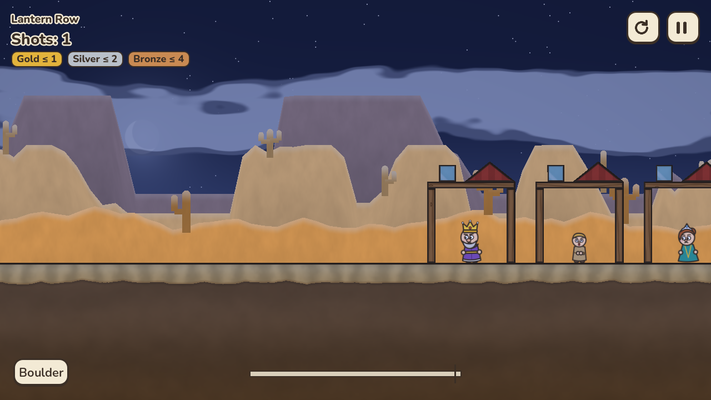
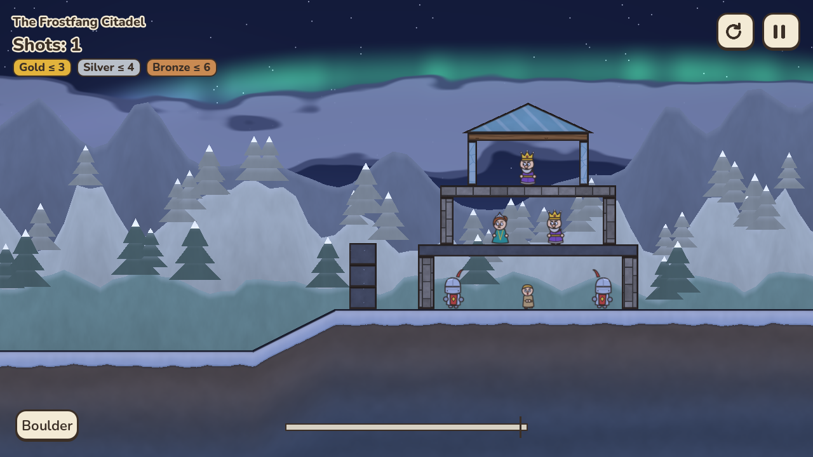
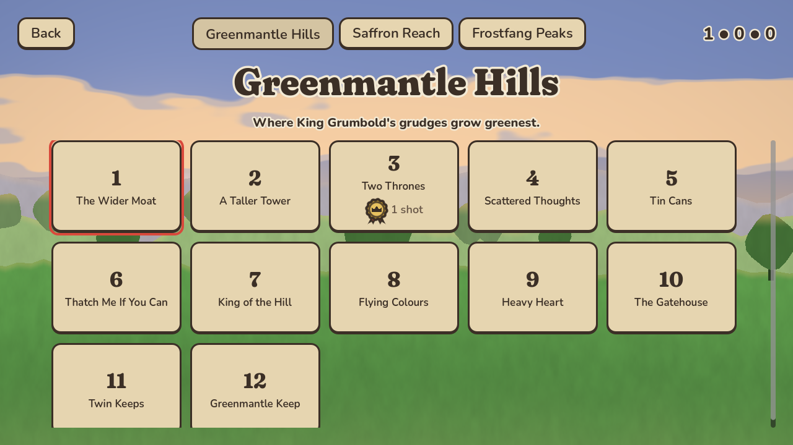
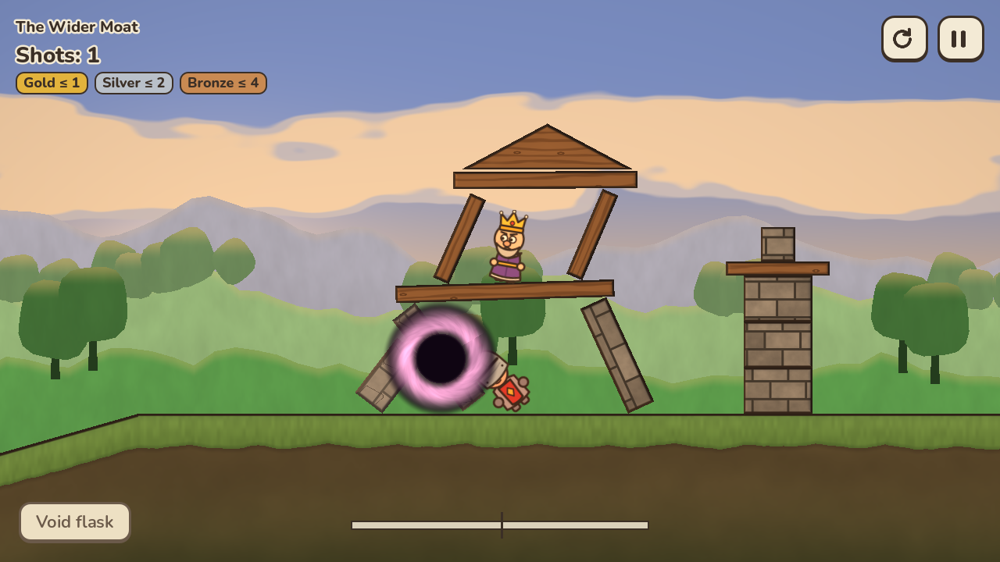
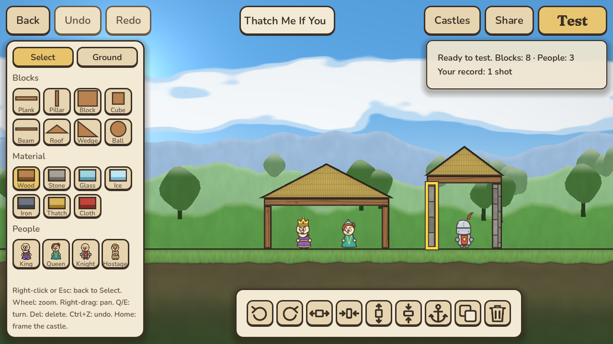
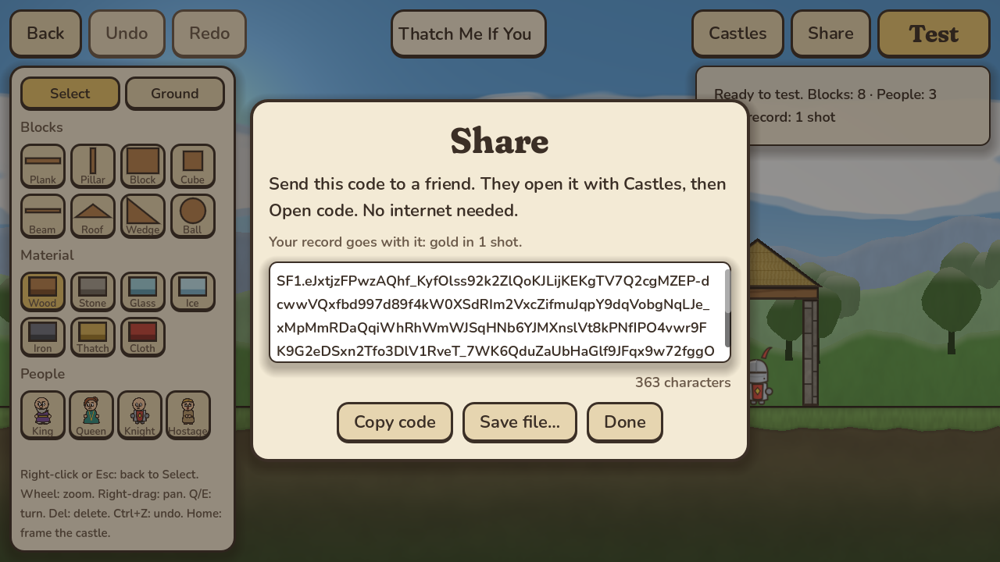

<!--
SPDX-FileCopyrightText: 2026 Siegefall contributors
SPDX-License-Identifier: CC-BY-SA-4.0
-->

# Siegefall

*Working title, see [docs/DESIGN.md §10](docs/DESIGN.md#10-naming).*

A free and open-source 2D physics game. A petty king wants his rivals'
castles flattened, and you have a trebuchet. Tap once to start the swing and
tap again to let go. The moment of release is your aim.

* Unlimited shots, with gold/silver/bronze medals for doing it in fewer
* 8 kinds of ammo (boulders, iron balls, powder kegs, frost flasks, a tiny
  black hole…) and 7 materials that each break their own way
* 3 realms × 12 levels, plus a castle builder with shareable level codes
* Made for Linux first, also on Windows and iOS
* No ads, no in-app purchases, no tracking, no network. Ever.

> **Status: release candidate 1.0.0-rc.1.** Milestones 0–7 are done: the
> full campaign (3 realms × 12 levels, each proven beatable by a bot that
> also sets par),
> eight ammo types, seven materials that crack and break into real pieces,
> fire and frost, procedural sound, level select, settings and accessibility
> options, a castle editor with offline share codes, and packages for
> Linux, Windows and iOS. Nothing has been published yet.
> See [docs/ROADMAP.md](docs/ROADMAP.md).

| | |
|---|---|
|  |  |
|  |  |
|  |  |
|  |  |
|  |  |
|  |  |

<sub>Rendered by `make screenshots` (software OpenGL, the low-quality tier).</sub>

## How to play

* **Tap / click / Space / gamepad A** once to start the swing and again to let
  go. Let go early for a high lob, later for a flat fast shot, and too late
  sends it into the dirt.
* Knock out every royal and knight. Fewer shots earn better medals.
* **R** restarts instantly, **Esc** pauses, and **Q / E** (or the shoulder
  buttons, or the mouse wheel) switch ammo once you have more than one.
* Some ammo has a mid-air action. Tap again in flight to burst scatter-stones,
  light a powder keg early, snap a chain shot or open a void flask.
* Settings → Access has one-button mode, a slower swing, reduced shake and
  flashing, material patterns that don't rely on colour, and text size.
  Every control can be remapped.

## Install

No release has been published yet. `make build && make package` produces
every package below in `dist/`; CI builds them on each push as well.

| System | Package | Install |
|---|---|---|
| Any Linux (x86_64, arm64) | `Siegefall-<ver>-<arch>.AppImage` | `chmod +x` it and run it |
| Any Linux | `siegefall-<ver>-linux-<arch>.tar.gz` | unpack, then `./install.sh` (to `~/.local`, no root) |
| Arch, CachyOS, Manjaro | AUR `siegefall-bin` or `siegefall` (from source) | `paru -S siegefall-bin` |
| Debian, Ubuntu, Mint | `siegefall_<ver>-1_<arch>.deb` | `sudo apt install ./siegefall_*.deb` |
| Fedora, openSUSE | `siegefall-<ver>-1.<arch>.rpm` | `sudo dnf install ./siegefall-*.rpm` / `sudo zypper install ./siegefall-*.rpm` |
| Flatpak | `Siegefall-<ver>.flatpak` | `flatpak install ./Siegefall-*.flatpak` |
| NixOS / Nix | `flake.nix` | `nix run github:oreo1298/ctc` |
| Windows 10/11 | `siegefall-<ver>-windows-x86_64-setup.exe` or `.zip` | run the installer (no admin rights), or unzip and play |
| iPhone, iPad | Xcode project / unsigned `.ipa` | build and sign it yourself: [docs/IOS.md](docs/IOS.md) |

From a clone, `make install` installs your own build into `~/.local` (or
`make install ARGS=--system` for `/usr/local`). Remove it with
`make uninstall`, or `~/.local/lib/siegefall/uninstall.sh`. Saves are kept
unless you add `--purge`. Packaging details are in
[docs/PACKAGING.md](docs/PACKAGING.md).

To build from source:

## Build from source

You need `git`, `bash` and `make`. Everything else is installed by the
bootstrap script, which detects your distro:

```bash
git clone https://github.com/oreo1298/ctc.git siegefall
cd siegefall
make dev      # = scripts/bootstrap.sh: packages (sudo), pinned Godot (no root)
make run      # play
make test     # unit tests + smoke test
make lint     # shellcheck, gdlint/gdformat, data schemas, REUSE
```

`scripts/bootstrap.sh --help` lists every option. Useful ones are
`--dry-run`, `--skip-packages` (no sudo at all) and `--editor-only` (skips
the 1.3 GB export templates).

### Per-distro notes

| Distro family | What `make dev` does |
|---|---|
| Arch, CachyOS, Manjaro, EndeavourOS | `pacman -S --needed …` |
| Debian, Ubuntu, Mint, Pop!_OS | `apt-get install …` |
| Fedora, Nobara | `dnf install …` |
| openSUSE Leap / Tumbleweed | `zypper install …` |
| Void | `xbps-install …` |
| Gentoo | `emerge --noreplace …` (Xvfb needs `USE=xvfb` on xorg-server) |
| NixOS | run `nix develop` first, then `make dev` inside the shell |
| Silverblue, Kinoite, Bazzite, SteamOS | no package layering: use distrobox (the script prints the exact commands) |
| anything else | prints the list of what's needed and exits |

The Godot editor (4.7.2-stable, pinned in [`toolchain.lock`](toolchain.lock)) is
downloaded into `~/.cache/siegefall-dev/` and checked against its official
SHA-512. Export templates go into `~/.local/share/godot/export_templates/`.

### Where your data lives

* Linux: saves and your castles in `~/.local/share/siegefall/`, settings in
  `~/.config/siegefall/` (Flatpak: under `~/.var/app/io.github.oreo1298.Siegefall/`)
* Windows: `%APPDATA%\siegefall\`

## Contributing

Contributions are welcome. See [CONTRIBUTING.md](CONTRIBUTING.md). Design
decisions are explained in [docs/DESIGN.md](docs/DESIGN.md), and the level
file format in [docs/LEVEL_FORMAT.md](docs/LEVEL_FORMAT.md).

## Licence

Code is [MIT](LICENSES/MIT.txt). Original art, audio, levels and docs are
[CC BY-SA 4.0](LICENSES/CC-BY-SA-4.0.txt). Third-party assets keep their own
licences, which are listed in [CREDITS.md](CREDITS.md). The repository is
[REUSE](https://reuse.software)-compliant.

Siegefall is an original game inspired by the genre that *Castle Clout* and
*Crush the Castle* started. It uses none of their names, art, sounds, or
levels.
