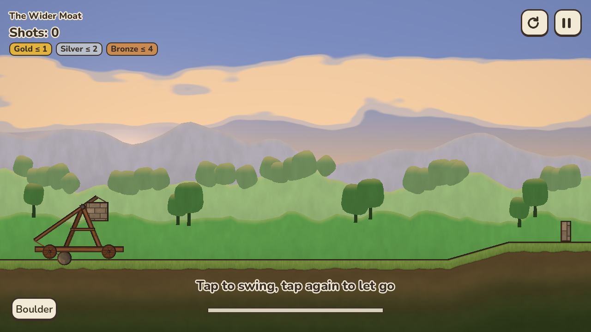
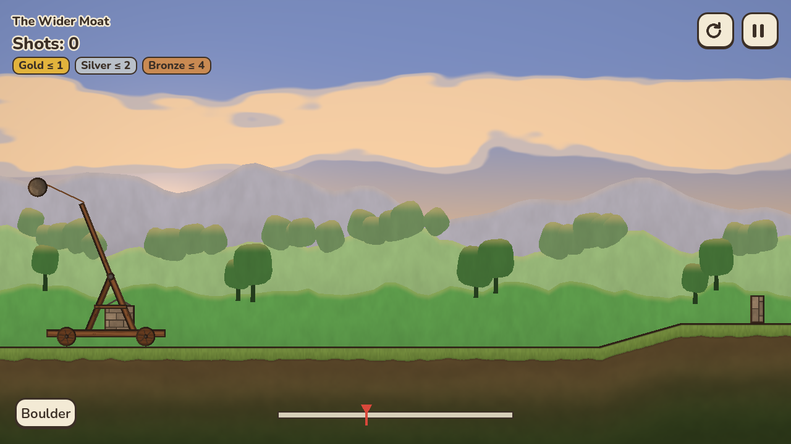
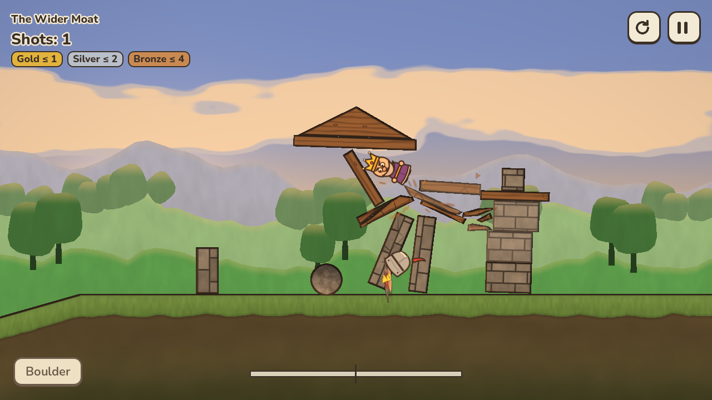
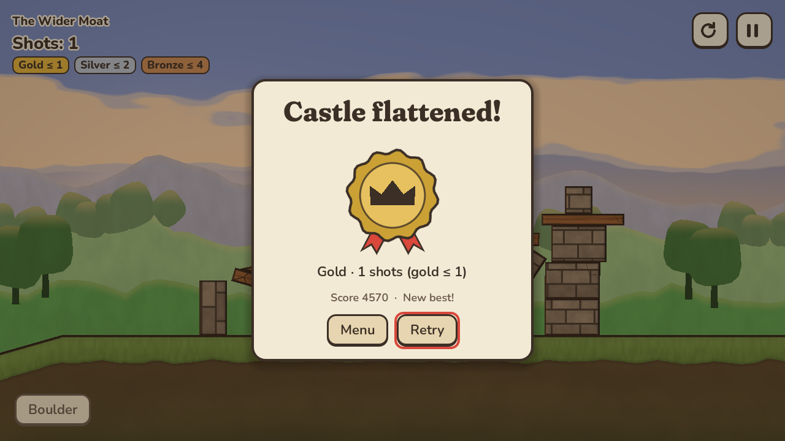
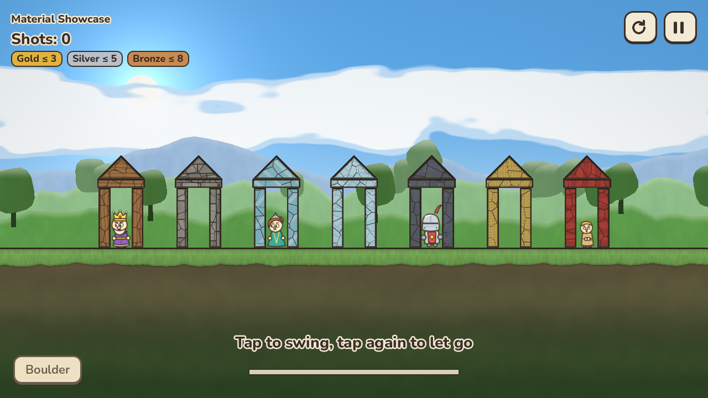
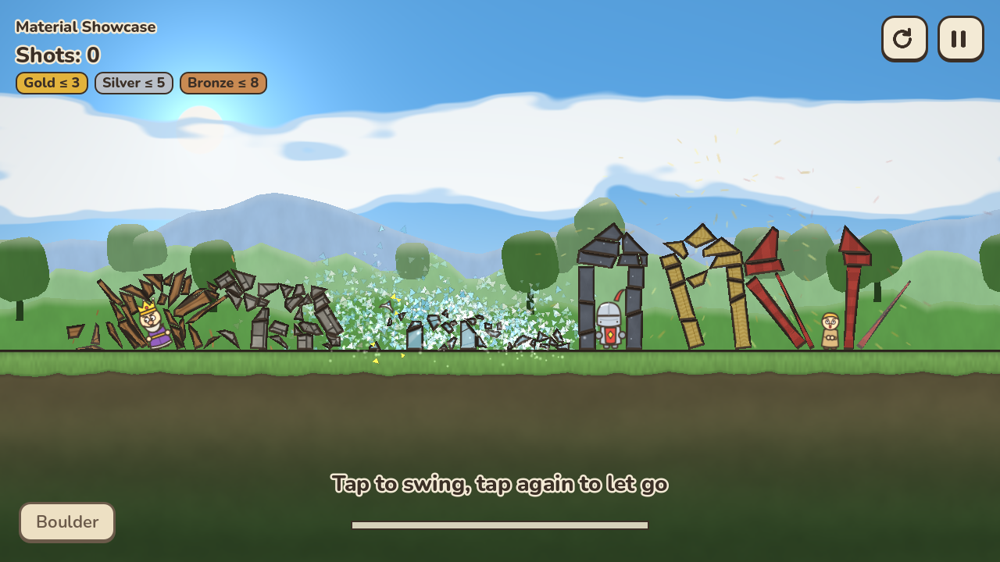

<!--
SPDX-FileCopyrightText: 2026 Siegefall contributors
SPDX-License-Identifier: CC-BY-SA-4.0
-->

# Siegefall

*Working title, see [docs/DESIGN.md §10](docs/DESIGN.md#10-naming).*

A free and open-source 2D physics game. A petty king wants his rivals'
castles flattened, and you have a trebuchet. Tap once to start the swing and
tap again to let go. The moment of release is your aim.

* Unlimited shots, with gold/silver/bronze medals for doing it in fewer
* 8 kinds of ammo (boulders, iron balls, powder kegs, frost flasks, a tiny
  black hole…) and 7 materials that each break their own way
* 3 realms × 12 levels, plus a castle builder with shareable level codes
* Made for Linux first, also on Windows and iOS
* No ads, no in-app purchases, no tracking, no network. Ever.

> **Status: early development.** Milestones 1–2 are done: a playable level
> with the two-tap trebuchet, seven materials that crack and break into real
> pieces, fire and frost, slow motion, dust, sparks and procedural sound.
> See [docs/ROADMAP.md](docs/ROADMAP.md).

| | |
|---|---|
|  |  |
|  |  |
|  |  |

<sub>Rendered by `make screenshots` (software OpenGL, the low-quality tier).</sub>

## How to play

* **Tap / click / Space / gamepad A** once to start the swing and again to let
  go. Let go early for a high lob, later for a flat fast shot, and too late
  sends it into the dirt.
* Knock out every royal and knight. Fewer shots earn better medals.
* **R** restarts instantly, **Esc** pauses, and **Q / E** (or the shoulder
  buttons, or the mouse wheel) switch ammo once you have more than one.

## Install

Packages (AppImage, Flatpak, .deb, .rpm, AUR, Nix, Windows zip and installer)
arrive in milestone 5. Until then, build from source:

## Build from source

You need `git`, `bash` and `make`. Everything else is installed by the
bootstrap script, which detects your distro:

```bash
git clone https://github.com/oreo1298/ctc.git siegefall
cd siegefall
make dev      # = scripts/bootstrap.sh: packages (sudo), pinned Godot (no root)
make run      # play
make test     # unit tests + smoke test
make lint     # shellcheck, gdlint/gdformat, data schemas, REUSE
```

`scripts/bootstrap.sh --help` lists every option. Useful ones are
`--dry-run`, `--skip-packages` (no sudo at all) and `--editor-only` (skips
the 1.3 GB export templates).

### Per-distro notes

| Distro family | What `make dev` does |
|---|---|
| Arch, CachyOS, Manjaro, EndeavourOS | `pacman -S --needed …` |
| Debian, Ubuntu, Mint, Pop!_OS | `apt-get install …` |
| Fedora, Nobara | `dnf install …` |
| openSUSE Leap / Tumbleweed | `zypper install …` |
| Void | `xbps-install …` |
| Gentoo | `emerge --noreplace …` (Xvfb needs `USE=xvfb` on xorg-server) |
| NixOS | run `nix develop` first, then `make dev` inside the shell |
| Silverblue, Kinoite, Bazzite, SteamOS | no package layering: use distrobox (the script prints the exact commands) |
| anything else | prints the list of what's needed and exits |

The Godot editor (4.7.2-stable, pinned in [`toolchain.lock`](toolchain.lock)) is
downloaded into `~/.cache/siegefall-dev/` and checked against its official
SHA-512. Export templates go into `~/.local/share/godot/export_templates/`.

### Where your data lives (Linux)

* Saves and custom levels: `~/.local/share/siegefall/`
* Settings: `~/.config/siegefall/`

## Contributing

Contributions are welcome. See [CONTRIBUTING.md](CONTRIBUTING.md). Design
decisions are explained in [docs/DESIGN.md](docs/DESIGN.md), and the level
file format in [docs/LEVEL_FORMAT.md](docs/LEVEL_FORMAT.md).

## Licence

Code is [MIT](LICENSES/MIT.txt). Original art, audio, levels and docs are
[CC BY-SA 4.0](LICENSES/CC-BY-SA-4.0.txt). Third-party assets keep their own
licences, which are listed in [CREDITS.md](CREDITS.md). The repository is
[REUSE](https://reuse.software)-compliant.

Siegefall is an original game inspired by the genre that *Castle Clout* and
*Crush the Castle* started. It uses none of their names, art, sounds, or
levels.
